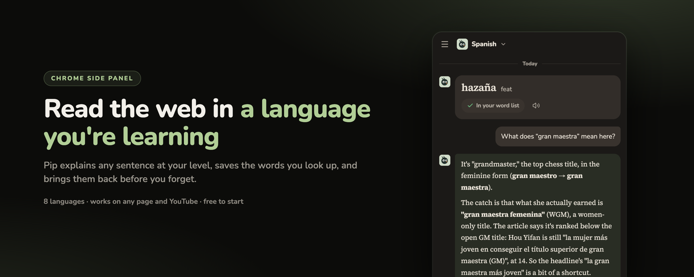

<h1 align="center">Iafine</h1>

  <b>Frontend · AI Agents · Full-stack</b> 
  Indie maker. I build AI products end to end.

  <a href="https://mossglen.app/en">Website</a>&nbsp;&nbsp;·&nbsp;&nbsp;
  <a href="https://x.com/iafineden">X</a>&nbsp;&nbsp;·&nbsp;&nbsp;
  <a href="https://www.youtube.com/@iafineden">YouTube</a>&nbsp;&nbsp;·&nbsp;&nbsp;
  <a href="https://www.tiktok.com/@iafineden">TikTok</a>

 

## Now building · Mossglen

Read any page or YouTube video in the language you're learning.
Tap a word to save it. Pip, a jackdaw, remembers your level and brings words back before you forget.

- **8 languages** — English, Japanese, Korean, Spanish, French, German, Italian, Portuguese
- **Right where you read** — side panel in Chrome and Edge, tappable YouTube transcripts
- **Inside your AI** — [connect it to ChatGPT or Claude](https://mossglen.app/en/ai), your words come along

**[Add to Chrome](https://chromewebstore.google.com/detail/cofjpdekcclaniimffbbkonekpijpbdc)**&nbsp;&nbsp;·&nbsp;&nbsp;**[Add to Edge](https://microsoftedge.microsoft.com/addons/detail/djldlnegpaomefcliimnblnijhhegjgf)**&nbsp;&nbsp;·&nbsp;&nbsp;**[Test your level](https://mossglen.app/en/level-test)**

 

## What I do

All of this runs in Mossglen today.

| | |
|---|---|
| **Frontend** | React · TypeScript · TanStack Router / Query / Form · Zustand · Tailwind A Manifest V3 extension for Chrome and Edge with a side panel, a prerendered site in 12 languages, an admin dashboard. |
| **AI Agents** | Pip, a tool-calling agent that remembers each learner. Zod-validated outputs, SSE streaming, every call logged. An MCP server with OAuth, so ChatGPT and Claude can use it. |
| **Full-stack** | Hono on Cloudflare Workers · D1 + Drizzle · Durable Objects · Cron A pnpm monorepo with shared contracts, and one command to ship four targets. |

 

Got an idea or want to work together? <a href="https://x.com/iafineden">DM me on X</a>.

